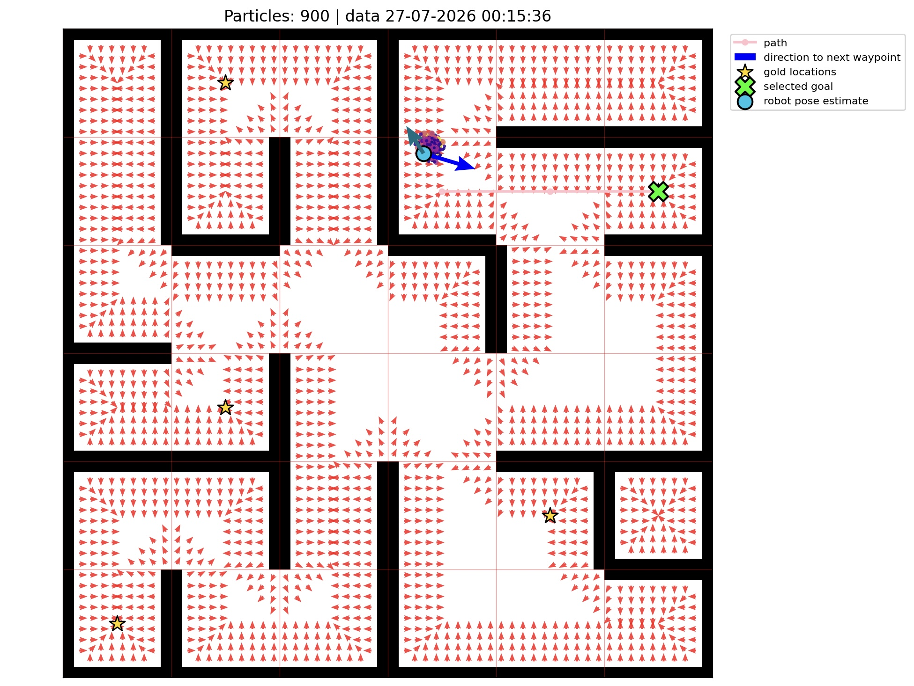

# LiDAR-Based Robot Localization and Maze Navigation

A ROS 2 course project for navigating a physical maze with LiDAR and no wheel encoders. Localization and navigation are implemented mainly in C++.

## Approach

- Particle-filter localization on a known grid map
- Dijkstra route planning and potential-field navigation
- Wall detection, heading alignment, and relocalization

## Navigation visualization

*Visualization captured while the robot was navigating the maze.*

## Robot demo

[Watch the robot navigate the physical maze](media/navigation_demo.mov).

## Main files

- `src/localization.cpp`: particle-filter localization
- `src/tracking.cpp`: motion estimation and route following
- `src/potential_field.cpp`: local navigation
- `src/dij_shortest_path.cpp`, `src/dij_gold_order.cpp`: route planning
- `src/ransac_node.cpp`, `src/align.cpp`: wall detection and alignment

## Requirements

Running this package requires the course-provided `create_fundamentals` package and the course robot's ROS 2 environment. Neither is included here, so this repository cannot be run on its own.
